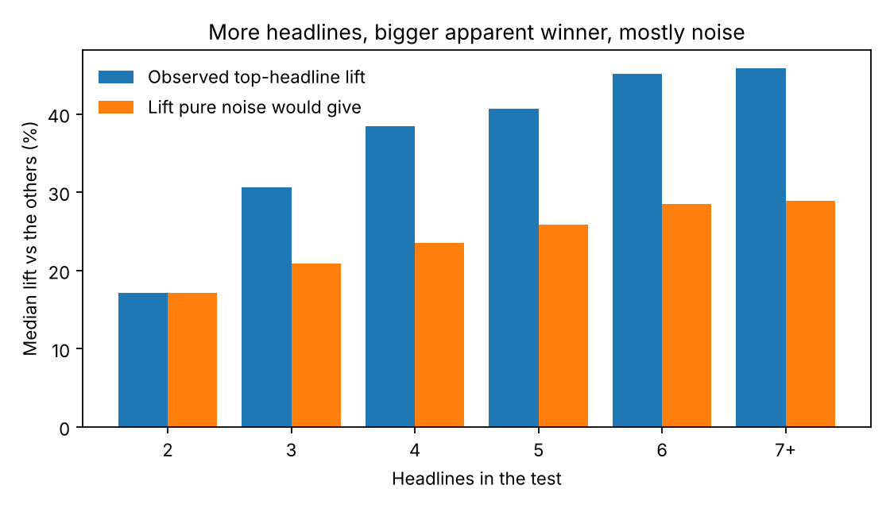

# When is an A/B test winner real?

**An analysis of 27,616 randomized headline tests (Upworthy Research Archive)**
`Python` `pandas` `scipy` `Tableau` · Notebook: `upworthy_ab_test_analysis.ipynb` · Dashboard: https://public.tableau.com/views/UpworthyABTestWhenIsaWinnerReal/WhenisanABtestwinnerreal

**The one-line answer:** don't ship the winner of a single test. Rerun it first.

Every content product runs this test: show people a few versions, ship the one with the most clicks. This project asks how often that winner is real and how often it got lucky. The data is Upworthy's record of 32,487 randomized headline tests from 2013 to 2015. I used the archive's exploratory set to find patterns and its confirmatory set (22,743 tests it set aside) to check them.

## What I found

1. **Headlines matter.** In 45% of clean tests, the headlines' click rates differ by more than chance allows (pure noise would give 5%).
2. **The winner looks bigger than it is.** The top headline beats the average of the others by a median 41%. Pure luck alone, with every headline given the same true click rate, would produce about 25%. The gap widens as tests add headlines.
3. **About 55% of the spread between headlines is real.** The rest is sampling noise.
4. **Typical tests are underpowered.** A headline got a median 3,118 impressions at a 1.3% click rate. At that size, a test needs about a 61% relative lift to detect it reliably.
5. **A few features replicate on tests I did not tune on:**

| Headline feature | Click rate vs other headlines in the same test (exploratory) | (confirmatory) |
|---|---|---|
| Contains a question mark | -8.7% | -8.4% |
| Contains a number | +5.3% | +6.0% |
| "this" / "these" | +3.9% | +5.1% |
| Emotional word | +4.5% | +5.3% |
| Negative word | +4.0% | +4.0% |
| Each extra word | +1.1% | +1.0% |

6. **A simple rule built on those features picks better.** On 17,832 held-out tests, the headline it likes best beats its test's other headlines 54.6% of the time (random pick: 48.1%), with a 9.4% average uplift (random: 2.9%). A modest edge, and a real one.

## What I'd tell a product team

- **Don't ship a winner from a many-headline test without a rerun.** Take the winner and the runner-up and test them against fresh traffic. The first result overstates the lift.
- **Run fewer headlines with more traffic each.** The inflated winner gets worse with every added headline.
- **Use the feature findings as a starting point for writing, not a rule.** Skip the question mark. Numbers, "this" and emotional language tend to help.
- **Check the traffic split before reading any result.** Tests from Jun 2013 to Jan 2014 had broken splits (79% failed the check versus 2% elsewhere), so I dropped them.

## Method

- Data: 27,616 tests across the two files; 21,657 after dropping the Jun 25 2013 to Jan 10 2014 window and tests with zero clicks.
- Balance: chi-square of impressions across headlines in each test.
- Do headlines differ: chi-square of clicks across headlines per test.
- Winner's curse: simulate each test 200 times with a shared click rate and compare the simulated top-headline lift with the observed one. For the confirmatory set I used a random 4,000-test sample to keep the run time short.
- Real share of variation: observed variance of log click rate minus expected sampling variance (method of moments).
- Features: within-test comparison, weighted by clicks, standard errors clustered by test.

## Limits

- The confirmatory tests are different tests, not reruns of the same headlines. They show the patterns hold on new stories, not that any single winner would win again.
- The outcome is clicks. Subscriptions, retention or time spent would need data this archive does not have.
- The data is from 2013 to 2015, and what works on a headline has probably shifted.
- The archive's `significance` column is not used. I recompute everything from raw clicks and impressions.

## Run it

1. Download the data from [OSF](https://osf.io/jd64p/) (folder `upworthy-archive-datasets`) and put the exploratory and confirmatory `.csv` files in a `data/` folder next to the notebook.
2. `pip install -r requirements.txt`, then open the notebook and run all cells. Takes about a minute.

Data: J. Nathan Matias and Kevin Munger, *The Upworthy Research Archive*, CC BY 4.0, DOI 10.17605/OSF.IO/JD64P.
